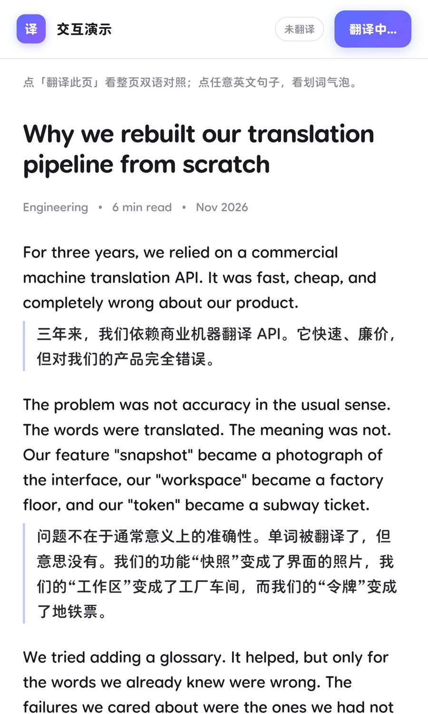

# 译界 · 划词与整页翻译

一个自己掌控的浏览器翻译扩展：**整页双语对照** + **划词气泡**，五个引擎可切，译文本地缓存，不订阅、不限量、不上传任何数据。（替代沉浸式翻译那类需要付费订阅的方案）



## 装上去

### 桌面 Chrome / Edge
1. 打开 `chrome://extensions`（Edge 是 `edge://extensions`）
2. 右上角打开「开发者模式」
3. 点「加载已解压的扩展程序」，选中解压后的目录
4. 建议钉到工具栏，方便点开设置

### Android（Kiwi / Lemur 狐猴 / Mises / Edge Canary）
1. 解压到手机存储，比如 `Download/translate-ext/`
2. 这些浏览器的扩展页里选「加载已解压的扩展程序」或「从文件夹安装」
3. 选中上面那个目录

> 手机 Chrome 官方还不支持普通扩展，别在它上面折腾。

## 怎么用

| 操作 | 效果 |
| --- | --- |
| 点扩展图标 → 「翻译当前页面」 | 整页双语对照，原文完整保留 |
| `Alt` + `T` | 整页翻译 / 还原 |
| 选中文字 | 自动弹气泡（原文 + 译文 + 复制 / 朗读 / 换引擎） |
| `Alt` + `S` | 翻译当前选区 |
| 右键菜单 | 翻译选中文本 / 整页翻译 / 朗读 |

译文以左侧竖线标出，滚动到哪翻到哪（懒加载），不会一次性把整页请求打出去。

## 引擎怎么选

| 引擎 | 要不要 Key | 说明 |
| --- | --- | --- |
| **微软（必应）** | 不用 | 默认。国内直连，返回里带 `usedLLM: true`——这条链路本身就是大模型在翻，不是老式统计机器翻译 |
| Google | 不用 | 需要能访问 `translate.googleapis.com`，国内网络基本不可用 |
| **DeepSeek** | 要 | 质量上限最高的一档，上下文 + 术语表都生效，按量计费很便宜 |
| OpenAI 兼容 | 要 | 官方 / 中转 / 本地 Ollama 都行，接口填到 `/v1` 为止 |
| DeepL | 要 | 免费 Key 以 `:fx` 结尾 |

**想翻得好就上大模型。** 免费引擎负责「看得懂」，大模型负责「读着像人话」。两个都能随时在弹出面板里切。

### 大模型引擎独有的两件事
- **上下文注入**：整页翻译时会把页面标题和 URL 一起发给模型，让它知道这是技术文档还是新闻稿，语气和术语判断更准。
- **术语表**：每行 `原文=译文`，例如
  ```
  token=令牌
  workspace=工作台
  ```
  强制模型采用你的译法，不再出现「令牌变地铁票」这种事。

## 已知限制

- 整页翻译只处理当前文档，**不翻 iframe 里的内容**。
- 微软引擎逐条请求（它的接口不接受批量），一屏 30 段大约 3–5 秒；大模型引擎 10 段一批，速度看你的接口。
- 页面用 canvas 画出来的文字、图片里的文字，都翻不了（这类得上 OCR，不在本扩展范围）。
- 首次用自定义接口地址时，浏览器会弹一次「授权访问该域名」，同意即可。

## 自己改

```
manifest.json      扩展声明（MV3）
background.js      引擎适配 / 缓存 / 消息路由 / 右键菜单
content.js         划词气泡（Shadow DOM 隔离）+ 整页翻译 + 还原
content.css        页面内译文块、进度胶囊、提示条样式
popup.*            设置面板
icons/             图标
preview/           本地演示页（不进扩展包）
test/harness.mjs   无浏览器端到端测试
```

跑测试（会真的请求必应接口）：

```bash
node --dns-result-order=ipv4first test/harness.mjs
```

加一个引擎：在 `background.js` 里写一个 `(texts, {sl, tl}) => string[]` 的函数，注册进 `ENGINES`，再到 popup 的 `ENGINE_LABELS` 里加个名字就行。
